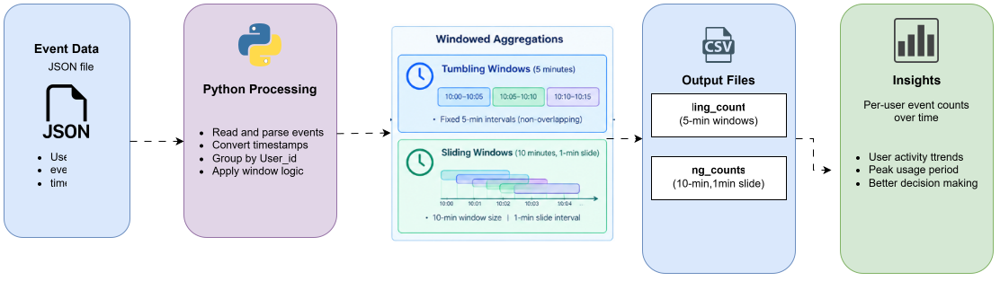
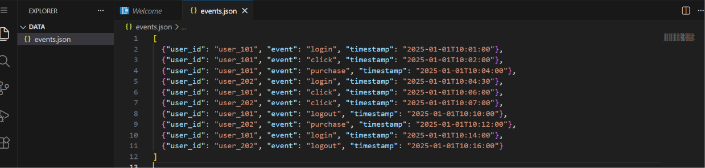
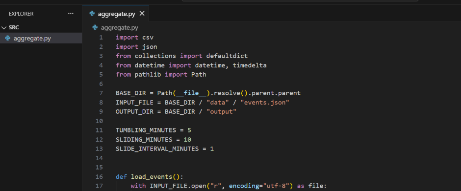
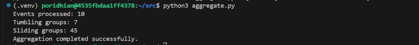
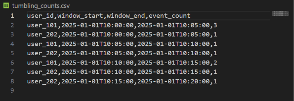
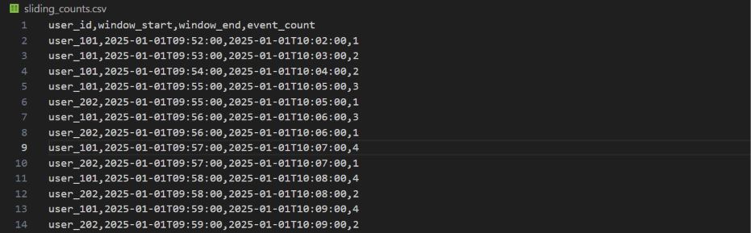
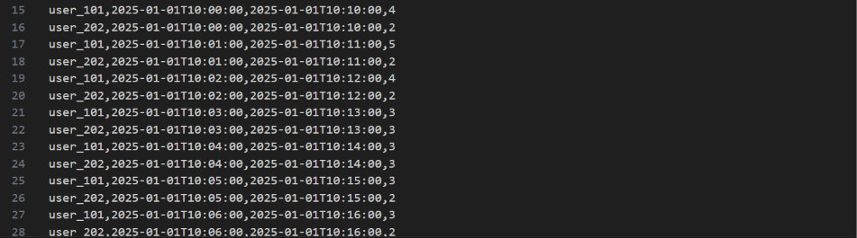
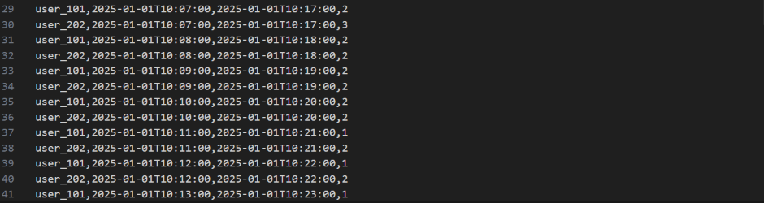
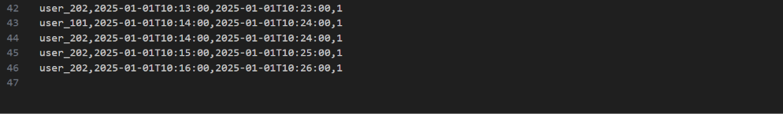
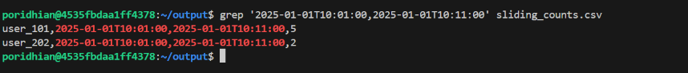

# Windowed Aggregations

**Level:** Intermediate  


## Introduction

At DataHive, Bob is developing an event-monitoring pipeline that receives timestamped activity records from multiple users. He needs to calculate how many events each user generates during fixed and overlapping time periods. To achieve this, Bob implements 5-minute tumbling windows and 10-minute sliding windows with a 1-minute slide interval, grouping every result by `user_id`.




## Project File Structure

Create the following project structure using the VS Code Server Explorer.

```text
windowed-aggregations/
├── data/
│   └── events.json
├── src/
│   └── aggregate.py
├── output/
│   ├── tumbling_counts.csv
│   └── sliding_counts.csv
└── README.md
```

The `data/` directory contains the input events, and `src/aggregate.py` contains the aggregation logic. The `output/` directory stores the generated CSV results. The `README.md` file documents the project overview and execution instructions.

## Chapter 1 — Prepare the Workspace

Open the VS Code Server terminal and execute:

```bash
mkdir -p windowed-aggregations/data windowed-aggregations/src windowed-aggregations/output
cd windowed-aggregations
python3 --version || python --version
```

Create a `README.md` in the `windowed-aggregations` root directory to document the project:

```markdown
# Windowed Aggregations

Pipeline for computing per-user event counts across 5-minute tumbling windows and 10-minute sliding windows.
```


The command creates separate directories for input data, source code, and output files. The Python version check confirms that Python is available in the environment. This lab uses Python's built-in standard libraries (`json`, `csv`, `datetime`, `collections`, `pathlib`), so installing external Python packages is not necessary.

## Chapter 2 — Create the Sample Event Dataset

In the VS Code Server Explorer, open the `data` directory and create a file named `events.json`. Add the following sample records:

```json
[
  {"user_id": "user_101", "event": "login", "timestamp": "2025-01-01T10:01:00"},
  {"user_id": "user_101", "event": "click", "timestamp": "2025-01-01T10:02:00"},
  {"user_id": "user_101", "event": "purchase", "timestamp": "2025-01-01T10:04:00"},
  {"user_id": "user_202", "event": "login", "timestamp": "2025-01-01T10:04:30"},
  {"user_id": "user_101", "event": "click", "timestamp": "2025-01-01T10:06:00"},
  {"user_id": "user_202", "event": "click", "timestamp": "2025-01-01T10:07:00"},
  {"user_id": "user_101", "event": "logout", "timestamp": "2025-01-01T10:10:00"},
  {"user_id": "user_202", "event": "purchase", "timestamp": "2025-01-01T10:12:00"},
  {"user_id": "user_101", "event": "login", "timestamp": "2025-01-01T10:14:00"},
  {"user_id": "user_202", "event": "logout", "timestamp": "2025-01-01T10:16:00"}
]
```



Each record includes a user identifier, an event type, and an ISO-8601 timestamp. The dataset contains two users (`user_101` and `user_202`) whose activity occurs across several 5-minute and 10-minute intervals between `10:01:00` and `10:16:00`. Notice that `user_202` has an event with sub-minute precision (`10:04:30`) and `user_101` has an event exactly on an interval boundary (`10:10:00`). These records verify that the aggregation logic correctly groups events and assigns them to the appropriate time windows.

## Chapter 3 — Implement Tumbling and Sliding Windows

In the VS Code Server Explorer, open the `src` directory and create `aggregate.py`. Add the following implementation:

```python
import csv
import json
from collections import defaultdict
from datetime import datetime, timedelta
from pathlib import Path

BASE_DIR = Path(__file__).resolve().parent.parent
INPUT_FILE = BASE_DIR / "data" / "events.json"
OUTPUT_DIR = BASE_DIR / "output"

TUMBLING_MINUTES = 5
SLIDING_MINUTES = 10
SLIDE_INTERVAL_MINUTES = 1


def load_events():
    with INPUT_FILE.open("r", encoding="utf-8") as file:
        events = json.load(file)

    for event in events:
        event["timestamp"] = datetime.fromisoformat(
            event["timestamp"]
        )

    return sorted(events, key=lambda event: event["timestamp"])


def aggregate_tumbling(events):
    counts = defaultdict(int)
    window_size = timedelta(minutes=TUMBLING_MINUTES)

    for event in events:
        timestamp = event["timestamp"]

        minute_of_day = timestamp.hour * 60 + timestamp.minute
        window_start_minute = (
            minute_of_day // TUMBLING_MINUTES
        ) * TUMBLING_MINUTES

        midnight = timestamp.replace(
            hour=0, minute=0, second=0, microsecond=0
        )

        window_start = midnight + timedelta(
            minutes=window_start_minute
        )
        window_end = window_start + window_size

        key = (
            event["user_id"],
            window_start,
            window_end,
        )
        counts[key] += 1

    return counts


def aggregate_sliding(events):
    counts = defaultdict(int)
    window_size = timedelta(minutes=SLIDING_MINUTES)
    num_windows = SLIDING_MINUTES // SLIDE_INTERVAL_MINUTES

    for event in events:
        timestamp = event["timestamp"]

        minute_of_day = timestamp.hour * 60 + timestamp.minute
        latest_start_minute = (
            minute_of_day // SLIDE_INTERVAL_MINUTES
        ) * SLIDE_INTERVAL_MINUTES

        midnight = timestamp.replace(
            hour=0, minute=0, second=0, microsecond=0
        )
        latest_window_start = midnight + timedelta(
            minutes=latest_start_minute
        )

        for step in range(num_windows):
            window_start = latest_window_start - timedelta(
                minutes=step * SLIDE_INTERVAL_MINUTES
            )
            window_end = window_start + window_size

            if window_start <= timestamp < window_end:
                key = (
                    event["user_id"],
                    window_start,
                    window_end,
                )
                counts[key] += 1

    return counts


def write_counts(counts, output_file):
    OUTPUT_DIR.mkdir(parents=True, exist_ok=True)

    rows = [
        {
            "user_id": user_id,
            "window_start": start.isoformat(),
            "window_end": end.isoformat(),
            "event_count": count,
        }
        for (user_id, start, end), count in counts.items()
    ]

    rows.sort(
        key=lambda row: (
            row["window_start"],
            row["user_id"],
        )
    )

    with output_file.open(
        "w", newline="", encoding="utf-8"
    ) as file:
        writer = csv.DictWriter(
            file,
            fieldnames=[
                "user_id",
                "window_start",
                "window_end",
                "event_count",
            ],
        )
        writer.writeheader()
        writer.writerows(rows)


def main():
    events = load_events()

    tumbling_counts = aggregate_tumbling(events)
    sliding_counts = aggregate_sliding(events)

    write_counts(
        tumbling_counts,
        OUTPUT_DIR / "tumbling_counts.csv",
    )
    write_counts(
        sliding_counts,
        OUTPUT_DIR / "sliding_counts.csv",
    )

    print(f"Events processed: {len(events)}")
    print(f"Tumbling groups: {len(tumbling_counts)}")
    print(f"Sliding groups: {len(sliding_counts)}")
    print("Aggregation completed successfully.")


if __name__ == "__main__":
    main()
```



The `load_events()` function reads the JSON records and converts their ISO timestamp strings into Python `datetime` objects. 

The `aggregate_tumbling()` function computes the start of each 5-minute fixed interval using integer division `(minute_of_day // TUMBLING_MINUTES) * TUMBLING_MINUTES`, assigning each event to exactly one non-overlapping window.

The `aggregate_sliding()` function aligns the event with the sliding grid using `SLIDE_INTERVAL_MINUTES` and computes all `SLIDING_MINUTES // SLIDE_INTERVAL_MINUTES` overlapping windows that cover the event's timestamp. 

Both functions use `(user_id, window_start, window_end)` as dictionary keys, isolating user events across distinct time intervals.

## Chapter 4 — Run the Aggregation Pipeline

Open the VS Code Server terminal from the project root and execute:

```bash
python3 src/aggregate.py
```
*(or `python src/aggregate.py` if running on Windows)*

The script processes the input records and prints the aggregation summary:




The pipeline processes all 10 events. Because it utilizes **sparse aggregation**, it outputs only the user-window combinations containing at least one event: 7 distinct tumbling groups and 45 overlapping sliding groups. The generated results are saved to `output/tumbling_counts.csv` and `output/sliding_counts.csv`.

## Chapter 5 — Inspect the Tumbling Window Results

In the VS Code Server Explorer, open `output/tumbling_counts.csv`. Verify that the event counts match the expected results:

| User | Window | Event count |
|---|---|---:|
| user_101 | 10:00–10:05 | 3 |
| user_202 | 10:00–10:05 | 1 |
| user_101 | 10:05–10:10 | 1 |
| user_202 | 10:05–10:10 | 1 |
| user_101 | 10:10–10:15 | 2 |
| user_202 | 10:10–10:15 | 1 |
| user_202 | 10:15–10:20 | 1 |

*(Note: The actual CSV file contains four columns: `user_id`, `window_start`, `window_end`, and `event_count` with full ISO timestamps. The table above summarizes the interval for readability.)*



Each user has a separate count for every 5-minute interval containing their activity. Notice the boundary event at `10:10:00` (`user_101` logout): it is assigned to the `10:10–10:15` window rather than `10:05–10:10` because window boundaries are half-open intervals `[start, end)` where the start timestamp is inclusive and the end timestamp is exclusive. Tumbling windows do not overlap, ensuring each event belongs to exactly one interval.

## Chapter 6 — Inspect the Sliding Window Results

Open `output/sliding_counts.csv` in the VS Code Server Explorer. Filter or find the records for the 10-minute window from `10:01` to `10:11` (`window_start`: `2025-01-01T10:01:00`, `window_end`: `2025-01-01T10:11:00`).






For that specific window, verify the counts:



| User | Window | Event count |
|---|---|---:|
| user_101 | 10:01–10:11 | 5 |
| user_202 | 10:01–10:11 | 2 |


The ten-minute window covers all events whose timestamps fall within `[10:01:00, 10:11:00)` (inclusive of `10:01:00`, exclusive of `10:11:00`). For `user_101`, the 5 events included are at 10:01, 10:02, 10:04, 10:06, and 10:10. The event at 10:14 is excluded. For `user_202`, the 2 events included are at 10:04:30 and 10:07. The events at 10:12 and 10:16 are excluded. 

Because sliding windows advance every 1 minute and span 10 minutes, an event can contribute to up to 10 overlapping windows for the same user.

## Chapter 7 — Verify the Output Files

Use the VS Code Server Explorer to confirm that the `output` directory contains both generated CSV files:

```text
output/
├── tumbling_counts.csv
└── sliding_counts.csv
```

Both files contain the schema `user_id`, `window_start`, `window_end`, and `event_count`. 

- `tumbling_counts.csv` contains 7 rows (plus header), representing the non-overlapping 5-minute active windows.
- `sliding_counts.csv` contains 45 rows (plus header), representing the active 10-minute overlapping windows across the timeline.

This confirms that user grouping, interval alignment, and boundary exclusions operate correctly across both fixed and overlapping window aggregations.

## Conclusion

In this lab, students implemented per-user event counting using 5-minute tumbling windows and 10-minute sliding windows with a 1-minute slide interval. They learned how window boundaries determine event membership using half-open intervals `[start, end)`, how overlapping windows capture moving activity trends, and how to structure and export aggregated time-series results to CSV files.